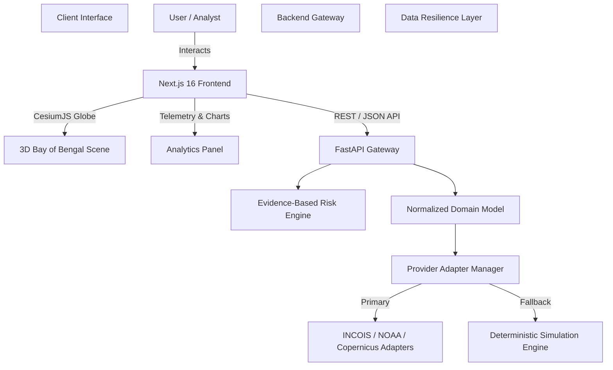

# 🌊 Ocean-X — 3D Ocean Intelligence & Disaster Decision-Support Platform

<div align="center">


[](https://nextjs.org/)
[](https://reactjs.org/)
[](https://fastapi.tiangolo.com/)
[](https://www.python.org/)
[](https://cesium.com/)
[](https://tailwindcss.com/)
[](LICENSE)

**An interactive 3D disaster-intelligence platform focused on the Bay of Bengal.**  
Ocean-X synthesizes oceanographic observations, atmospheric dynamics, and cyclone telemetry into actionable decision-support insights.

[Features](#-key-features) • [Tech Stack](#-tech-stack) • [Architecture](#-architecture) • [Getting Started](#-getting-started) • [API Spec](#-api-endpoints) • [Data Strategy](#-data-resiliency--trust-engine)

</div>

---

## 🌟 Overview

Ocean-X (OceanLens) provides real-time and projected environmental telemetry to researchers, disaster-management authorities, and coastal planners. By standardizing marine data pipelines into an interactive **3D CesiumJS globe**, Ocean-X enables decision-makers to track storm surges, analyze sea-surface temperature anomalies, and evaluate coastal vulnerability in real time.

```
Observe ──► Analyze ──► Predict/Project ──► Explain ──► Assess Impact
```

> ⚠️ **Note:** Ocean-X is a decision-support and visualization prototype designed for hazard analysis and research simulation. It is not intended to supersede official meteorological warning systems.

---

## ✨ Key Features

- **🌐 3D Bay of Bengal Globe:** Dynamic camera positioning, high-resolution bathymetric & satellite imagery rendered via **CesiumJS**.
- **🌀 Cyclone Telemetry & Hazard Tracking:** Historical replay and forecast projections with storm tracks, central pressure, maximum sustained wind speeds, and coastal proximity.
- **🌊 Multi-Layer Environmental Data:** Toggleable layers for:
  - **Ocean Currents** (velocity vectors & direction)
  - **Wind Dynamics** (surface wind vectors)
  - **Sea Surface Temperature (SST)**
  - **Wave Height & Period**
  - **Coastal Monitoring Station Feeds**
- **🛡️ Evidence-Based Risk Explainer:** Transparent risk scoring engine evaluating wind severity, wave heights, and exposure parameters without black-box ML claims.
- **🔄 Data Resiliency Engine:** Seamless fallback between live provider APIs (INCOIS, NOAA IBTrACS, Copernicus) and deterministic local simulation models when external APIs are unavailable.
- **⏱️ Time-Machine Timeline Playback:** Interactive time slider supporting historical event reconstruction and forecast horizon browsing.

---

## 🛠️ Tech Stack

### **Frontend (`/frontend`)**
| Technology | Role |
| :--- | :--- |
| **Next.js 16 (App Router)** | Full-stack React framework for high-performance UI rendering |
| **React 19 & TypeScript 5** | Type-safe UI components and state management |
| **CesiumJS (v1.145)** | WebGL 3D globe visualization and geospatial entity rendering |
| **Tailwind CSS v4** | Utility-first styling with modern PostCSS pipeline |
| **Recharts** | Interactive oceanographic trend charts and telemetry graphs |
| **Lucide Icons** | Modern icon set for data dashboards and GIS toggles |

### **Backend (`/backend`)**
| Technology | Role |
| :--- | :--- |
| **FastAPI (>= 0.110)** | High-throughput asynchronous Python REST API gateway |
| **Uvicorn** | Lightning-fast ASGI web server implementation |
| **Pydantic v2** | Strict data validation and OpenAPI schema generation |
| **`xarray` & `netCDF4`** | Multi-dimensional climate and oceanographic dataset operations |
| **`numpy`, `pandas` & `dask`** | Numerical computing, spatial grids, and out-of-core data processing |
| **Pytest & HTTPX** | Async integration testing & external API client handling |

---

## 📐 Architecture

Ocean-X uses a **Source-Agnostic Adapter Pattern** separating data provider integrations from the visualization interface:



---

## 🚀 Getting Started

### **Prerequisites**
- **Node.js** >= 18.0.0
- **npm** >= 9.0.0
- **Python** >= 3.10
- **Git**

---

### **1. Clone the Repository**

```bash
git clone https://github.com/ZoroDev0/Ocean-X.git
cd Ocean-X
```

---

### **2. Backend Setup**

```bash
# Navigate to backend directory
cd backend

# Create a virtual environment
python -m venv .venv

# Activate virtual environment
# Windows (PowerShell):
.venv\Scripts\Activate.ps1
# macOS/Linux:
source .venv/bin/activate

# Install dependencies
pip install -r requirements.txt

# Start the FastAPI server
uvicorn app.main:app --reload --port 8000
```
> The API server will run at `http://localhost:8000`. Access interactive API documentation at `http://localhost:8000/docs`.

---

### **3. Frontend Setup**

```bash
# Navigate to frontend directory (from project root)
cd frontend

# Install dependencies
npm install

# Run the development server
npm run dev
```
> The web app will run at `http://localhost:3000`.

---

## 📡 API Endpoints

| Endpoint | Method | Description |
| :--- | :--- | :--- |
| `/api/v1/health` | `GET` | Health check endpoint returning system & adapter status |
| `/api/v1/cyclones` | `GET` | Retrieve active & historical cyclone telemetry tracks |
| `/api/v1/stations` | `GET` | Get monitoring station data (buoys, coastal meters) |
| `/api/v1/layers/{type}` | `GET` | Fetch environmental layer grids (wind, current, SST, waves) |
| `/api/v1/impact-analysis` | `GET` | Evidence-based risk score & coastal vulnerability analysis |

---

## 🔒 Data Resiliency & Trust Engine

Ocean-X adheres to strict data transparency rules:
1. **Source Transparency:** Every response includes metadata tags (`source`, `timestamp`, `units`, `status`).
2. **Status Flagging:** Datasets are explicitly tagged as `REAL`, `SIMULATED`, or `MIXED`.
3. **Graceful Fallback:** If an external data provider experiences downtime, Ocean-X automatically switches to local deterministic models while maintaining full UI responsiveness and clearly flagging the state to the user.

---

## 📁 Repository Structure

```
Ocean-X/
├── backend/                  # Python FastAPI Backend
│   ├── app/
│   │   ├── api/              # API Routers & Endpoints
│   │   ├── core/             # Configuration & Risk Rules
│   │   ├── models/           # Domain Pydantic Schemas
│   │   ├── providers/        # Real & Simulated Data Adapters
│   │   ├── services/         # Dataset & GIS Logic
│   │   └── main.py           # FastAPI Application Entry
│   ├── tests/                # Pytest Test Suites
│   └── requirements.txt      # Python Dependencies
├── frontend/                 # Next.js 16 Frontend
│   ├── src/
│   │   ├── app/              # App Router Pages & Layouts
│   │   ├── components/       # Cesium Globe & UI Overlay Panels
│   │   ├── services/         # API Client & Data Fetchers
│   │   ├── types/            # TypeScript Interface Definitions
│   │   └── utils/            # GIS & Calculation Helpers
│   ├── package.json          # Node Dependencies
│   └── next.config.ts        # Next.js Configuration
└── docs/                     # Comprehensive Architecture & PRD Docs
    ├── PRD.md                # Product Requirements Document
    ├── System_Architecture.md# System Architecture & Component Design
    ├── API_Specification.md  # Detailed API Contract Specs
    └── Dataset_Specification.md
```

---

## 🤝 Contributing & License

Contributions are welcome! Please open an issue or submit a pull request for any enhancements, dataset adapters, or visualization improvements.

Distributed under the **MIT License**. See `LICENSE` for details.

---

<div align="center">
Made with ❤️ for Marine Science & Coastal Protection in the Bay of Bengal.
</div>
