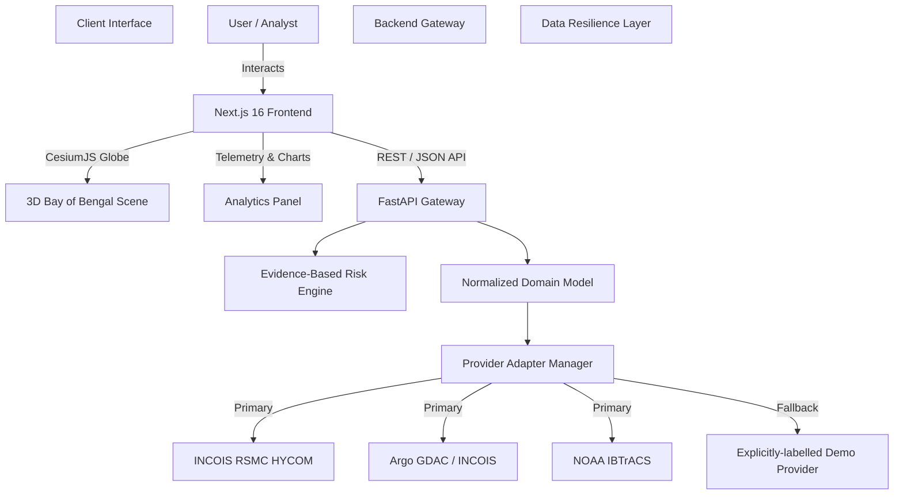

# 🌊 Ocean-X — 3D Ocean Intelligence & Disaster Decision-Support Platform

<div align="center">


[](https://nextjs.org/)
[](https://reactjs.org/)
[](https://fastapi.tiangolo.com/)
[](https://www.python.org/)
[](https://cesium.com/)
[](https://tailwindcss.com/)
[]()

**An interactive 3D disaster-intelligence platform focused on the Bay of Bengal.**  
Ocean-X synthesizes oceanographic observations, atmospheric dynamics, and cyclone telemetry into actionable decision-support insights.

[Quick Start](#quick-start) • [Features](#-key-features) • [Tech Stack](#-tech-stack) • [Architecture](#-architecture) • [Getting Started](#-getting-started) • [API Spec](#-api-endpoints) • [Data Strategy](#-data-resiliency--trust-engine)

</div>

---

## 🌟 Overview

Ocean-X (OceanLens) provides real-time and projected environmental telemetry to researchers, disaster-management authorities, and coastal planners. By standardizing marine data pipelines into an interactive **3D CesiumJS globe**, Ocean-X enables decision-makers to track storm surges, analyze sea-surface temperature anomalies, and evaluate coastal vulnerability in real time.

```
Observe ──► Analyze ──► Predict/Project ──► Explain ──► Assess Impact
```

> ⚠️ **Note:** Ocean-X is a decision-support and visualization prototype designed for hazard analysis and research simulation. It is not intended to supersede official meteorological warning systems.

---

## Quick Start

There are **two ways to run OCEAN-X**:

1. **SIH Demo / Fixture Mode** — recommended for a fresh clone. Uses the small
   synthetic, schema-compatible HYCOM fixtures committed to this repository.
   **No large download is required.**
2. **REAL Production HYCOM Mode** — only required for actual production HYCOM
   runtime verification. Requires the ~10.58 GB INCOIS HYCOM dataset to be
   installed and processed locally (see
   [Optional: REAL Production HYCOM](#optional-real-production-hycom)).

> ✅ **The normal SIH demo does NOT require downloading the ~10.58 GB production
> HYCOM dataset.** The repository contains small synthetic HYCOM fixtures for
> development and testing (`backend/tests/fixtures/hycom_raw_fixture.nc` and
> `backend/tests/fixtures/hycom_surface_fixture.nc`).

---

### Fresh Clone — SIH Demo (FIXTURE mode)

#### 1. Clone the repository

```bash
git clone https://github.com/ZoroDev0/Ocean-X.git
cd Ocean-X
```

#### 2. Backend setup

```bash
cd backend
python3 -m venv .venv
source .venv/bin/activate    # Windows PowerShell: .\.venv\Scripts\Activate.ps1
pip install -r requirements.txt
```

#### 3. Frontend setup

```bash
cd frontend
npm install
```

#### 4. Validate the FIXTURE data

With the backend virtual environment active:

```bash
cd backend
source .venv/bin/activate
OCEANX_DATA_MODE=FIXTURE python ../scripts/check-data.py
```

Expected output ends with:

```
Required HYCOM data available: YES (synthetic fixtures)
NOTE: These are SYNTHETIC TEST FIXTURES.
```

- **FIXTURE mode is explicit.** It is used only when `OCEANX_DATA_MODE=FIXTURE`
  is set; it never activates silently.
- It uses the **committed synthetic, schema-compatible fixtures** in
  `backend/tests/fixtures/` (constant placeholder values — not ocean measurements).
- It is intended for the **SIH demo and development/testing** only.
- It is **NOT scientific or production validation**, and fixture output must never
  be presented as scientific evidence.
- **Argo provenance is unchanged:** Argo profiles remain separately identified as
  real/in-situ (`REAL SOURCE — INGESTION PENDING`); the synthetic label applies
  only to the HYCOM model fields served in FIXTURE mode.

#### 5. Run OCEAN-X

Terminal 1 — backend (FIXTURE mode):

```bash
cd backend
source .venv/bin/activate
OCEANX_DATA_MODE=FIXTURE uvicorn app.main:app --reload --port 8000
```

Terminal 2 — frontend:

```bash
cd frontend
npm run dev
```

Open **http://localhost:3000** in your browser (Next.js dev-server default). The
backend listens on **http://localhost:8000**, and interactive API documentation
is available at **http://localhost:8000/docs**.

The frontend already defaults to the API base `http://127.0.0.1:8000/api`, so no
extra configuration is needed. To point it elsewhere, set `NEXT_PUBLIC_API_URL`
in `frontend/.env.local` (see `docs/DEMO_RUNBOOK.md` for the full variable table).

#### Windows / PowerShell

The same flow in PowerShell (the project also ships a PowerShell data-download
helper at `backend/scripts/download_incois.ps1`):

```powershell
cd backend
.\.venv\Scripts\Activate.ps1
$env:OCEANX_DATA_MODE="FIXTURE"
python ..\scripts\check-data.py
uvicorn app.main:app --reload --port 8000
```

```powershell
cd frontend
npm install
npm run dev
```

Use `python` (not `python3`) on Windows. These are the PowerShell equivalents
used elsewhere in the project (see `docs/DEMO_RUNBOOK.md`); no broader Windows
support is claimed beyond what the repository already provides.

#### Data modes

| Mode                   | Purpose                        | Production HYCOM required? | Scientific interpretation                          |
| ---------------------- | ------------------------------ | -------------------------- | -------------------------------------------------- |
| `FIXTURE`              | SIH demo / development / tests | No                         | Synthetic, not scientific evidence                 |
| `REAL`                 | Production runtime             | Yes                        | Production-backed only when the dataset is loaded  |
| `REAL` with missing data | Safe unavailable state       | Yes, but absent            | Must not be interpreted as production data         |

`OCEANX_DATA_MODE` defaults to `REAL`. Setting `OCEANX_DATA_MODE=REAL` does
**not** by itself make data production-backed — the production dataset must
actually be installed and processed. When it is absent, the backend reports an
honest unavailable/`DATASET UNAVAILABLE` status rather than substituting values.
See [🔵 Data Modes — REAL vs FIXTURE](#-data-modes--real-vs-fixture) for details.

#### Troubleshooting

**"HYCOM dataset not found"** — Expected for a fresh clone when running in REAL
mode: the ~10.58 GB production dataset is intentionally not committed to Git. For
the SIH demo, run in FIXTURE mode (`OCEANX_DATA_MODE=FIXTURE`) as shown above.

**"Backend unavailable"** — Confirm the backend is running by checking
`http://localhost:8000/api/health` (or opening `http://localhost:8000/docs`), and
that it was started with the intended `OCEANX_DATA_MODE`. When the backend is
unreachable, the frontend visibly identifies a disconnected / demo /
non-authoritative state rather than silently presenting data as production.

**Python environment** — Activate the virtual environment before running backend
commands: `source .venv/bin/activate` (macOS/Linux) or
`.\.venv\Scripts\Activate.ps1` (Windows PowerShell), from inside `backend/`.

**Frontend dependencies** — `npm install` must be run inside the `frontend/`
directory (it installs from `frontend/package.json`).

#### Developer documentation

- [`docs/DEMO_RUNBOOK.md`](docs/DEMO_RUNBOOK.md) — step-by-step demo/judge runbook (FIXTURE & REAL modes)
- [`docs/API_Specification.md`](docs/API_Specification.md) — API contract specifications
- [`docs/PRD.md`](docs/PRD.md) — product requirements
- [`docs/INDEX.md`](docs/INDEX.md) — full documentation index
- [`docs/superpowers/`](docs/superpowers/) — design specs and execution artifacts
- [`docs/superpowers/plans/`](docs/superpowers/plans/) — project plans (retained for future developers)

---

## ✨ Key Features

- **🌐 3D Bay of Bengal Globe:** Dynamic camera positioning, high-resolution bathymetric & satellite imagery rendered via **CesiumJS**.
- **🌀 Cyclone Telemetry & Hazard Tracking:** Historical replay and forecast projections with storm tracks, central pressure, maximum sustained wind speeds, and coastal proximity.
- **🌊 Multi-Layer Environmental Data:** Toggleable layers, all backed by real INCOIS HYCOM output:
  - **Ocean Currents** (HYCOM UVEL/VVEL velocity vectors)
  - **Sea Surface Temperature (SST)** · **Sea Surface Salinity** · **Sea Surface Height (SSH)**
  - **Mixed Layer Depth (MLD)**
  - **Tropical Cyclone Heat Potential (TCHP)**
  - **Argo Observations** (real GDAC in-situ profiles, T/S vs depth)
- **🧪 Argo–Model Validation:** Real Argo profiles matched against real HYCOM runs, with QC policy, a time-gap guard, honest nulls, and depth-axis provenance. The TCHP/D26 comparison is genuinely computed, not mocked.
- **🌀 Cyclone Telemetry:** Historical best-track replay from NOAA IBTrACS with per-point agency provenance (WMO / IMD), observed wind radii, and a data-completeness report.
- **🛡️ Unvalidated Risk Demo:** A clearly-labelled **heuristic demo score** (`heuristicDemoScore`), never a forecast. It returns `UNAVAILABLE` with a reason rather than scoring on invented inputs, ships its weights in every response, and is marked **not validated, not for operational use** in the UI.
- **🔄 Data Resiliency:** Falls back to an explicitly-labelled **demo provider** (never a silent simulation) when the backend is unreachable.

> **Not implemented (removed):** the wave-height layer, the parametric surface-wind layer, and the coastal monitoring-station feeds. Each was permanently synthetic with no data behind it, so they were removed rather than shipped mislabelled. The impact-analysis endpoint does not exist.
- **⏱️ Time-Machine Timeline Playback:** Interactive time slider supporting historical event reconstruction and forecast horizon browsing.

---

## 🛠️ Tech Stack

### **Frontend (`/frontend`)**
| Technology | Role |
| :--- | :--- |
| **Next.js 16 (App Router)** | Full-stack React framework for high-performance UI rendering |
| **React 19 & TypeScript 5** | Type-safe UI components and state management |
| **CesiumJS (v1.145)** | WebGL 3D globe visualization and geospatial entity rendering |
| **Tailwind CSS v4** | Utility-first styling with modern PostCSS pipeline |
| **Recharts** | Interactive oceanographic trend charts and telemetry graphs |
| **Lucide Icons** | Modern icon set for data dashboards and GIS toggles |

### **Backend (`/backend`)**
| Technology | Role |
| :--- | :--- |
| **FastAPI (>= 0.110)** | High-throughput asynchronous Python REST API gateway |
| **Uvicorn** | Lightning-fast ASGI web server implementation |
| **Pydantic v2** | Strict data validation and OpenAPI schema generation |
| **`xarray` & `netCDF4`** | Multi-dimensional climate and oceanographic dataset operations |
| **`numpy`, `pandas` & `dask`** | Numerical computing, spatial grids, and out-of-core data processing |
| **Pytest & HTTPX** | Async integration testing & external API client handling |

---

## 💾 Data

A fresh clone runs the **whole app on real ocean data**. The multi-gigabyte
HYCOM runs are not in Git, but a coarsened **subset of those same real files**
is, so a new clone has SST, salinity, currents, TCHP, SSH, MLD, depth slices and
a working Argo–model matchup without downloading anything.

### Committed to Git — real data, ships with the clone

| Dataset | Path | Size | Notes |
| :--- | :--- | :--- | :--- |
| **HYCOM demo subset (surface)** | `backend/data/demo/processed/ocean/incois_hycom_bob_surface.nc` | 12.9 MB | Real INCOIS HYCOM surface field, 7 time steps (2026-10-07 06:00 → 2026-10-08 18:00 UTC), full 347×334 Bay-of-Bengal grid, float32 + zlib. |
| **HYCOM demo subset (depth-resolved)** | `backend/data/demo/raw/ocean/currents/RSMC_hycom_20261004_bob_subset.nc` | 10.1 MB | Real INCOIS HYCOM run, 6 native depth levels (0, 17.5, 52.5, 125, 275, 500 m), 8 of 28 time steps (2026-10-03 06:00 → 2026-10-10 00:00 UTC), every 2nd LAT/LON point → 175×167 grid, float32 + zlib. |
| NOAA IBTrACS North Indian Ocean | `backend/data/raw/cyclones/ibtracs/ibtracs.NI.list.v04r01.csv` | ~27 MB | Force-tracked despite the `backend/data/raw/` ignore rule. Cyclone tracks, seasons ≥ 2020. |
| Argo profiles (23 floats / 23 profiles / 6,560 levels) | `backend/data/processed/ocean/argo/argo_bob_processed.json` | ~2.4 MB | Real GDAC/INCOIS data, Oct 2026, Bay of Bengal. Provenance in `argo_bob_metadata.json`. |
| Synthetic schema fixtures | `backend/tests/fixtures/hycom_*.nc` | ~90 KB | `synthetic='true'` in the NetCDF attrs. `FIXTURE` mode / CI only — **not scientific evidence**. |

**Total demo subset: 23 MB.** With IBTrACS and Argo that is ~52 MB of data in
the clone.

#### The demo subset is real data, thinned — never invented

Both demo files are a **subsample of published INCOIS output**. Every kept
number is the number the publisher wrote, at the index it was written at:
no interpolation, no averaging, no synthetic fill, no invented timestamps. Only
whole grid points and whole time steps are dropped. Each file records this in
its NetCDF global attributes:

```
subset_of          RSMC_hycom_20261004_bob_subset.nc
subset_method      coarsened real HYCOM subset: every 2nd LAT and 2nd LON grid
                   point, 8 of 28 time steps kept; values subsampled only,
                   never interpolated, averaged or replaced
data_status        REAL          # no `synthetic` flag is ever written
time_steps_kept    8
time_steps_source  28
```

The time steps were chosen so the Argo–model matchup stays meaningful: all 23
committed profiles land within the 24 h matchup window (mean separation 6.4 h),
versus the ~10 that were required.

#### `dataScope`: the app tells you which one you are looking at

`/status`, `/layers` and `/datasets` report a `dataScope`:

| Value | Meaning |
| :--- | :--- |
| `FULL` | The production HYCOM files are installed at their normal paths. |
| `DEMO SUBSET (real HYCOM, coarsened)` | Running on the committed 23 MB subset. Real HYCOM values at lower resolution and fewer time steps. |

The data stays `REAL` in both cases — a coarsened real subset is not synthetic,
and labelling it as such would make the app hide data it can honestly show. In
the header ribbon, Live mode publishes **both** model windows when they differ
(they come from two different HYCOM runs) and states how old the newest one is;
data older than 24 h is never called "live".

#### Regenerating the demo subset

Only needed when the installed HYCOM runs change. The script thins the files
that are already on disk — it never creates data of its own:

```bash
cd backend
python scripts/make_demo_subset.py --dry-run                     # report the plan
python scripts/make_demo_subset.py     --depth-run RSMC_hycom_20261004_bob_subset.nc     --lat-stride 2 --lon-stride 2 --time-step 4                  # the committed defaults
python scripts/make_demo_subset.py --lat-stride 4 --lon-stride 4 # a smaller subset (~7 MB)
```

The script prints what it wrote and refuses to leave anything over the 60 MB
hard limit (40 MB target). Useful flags: `--depth-run` (which run to thin),
`--surface-lat-stride/--surface-lon-stride` (the surface file is kept at full
resolution by default), `--time-step`, `--compression-level`, `--demo-dir`.

### NOT in Git — installed separately (~2.3 GB)

| Dataset | Path | Notes |
| :--- | :--- | :--- |
| HYCOM daily subsets (6 runs) | `backend/data/raw/ocean/currents/RSMC_hycom_*.nc` | ~379 MB each. Real INCOIS output (`PyFerret V7.63`, CF-1.6). |
| Processed surface field | `backend/data/processed/ocean/incois_hycom_bob_surface.nc` | ~13.5 MB. Derived from the runs above. |

Both are covered by `.gitignore`. **When they are installed they take priority**
and `dataScope` becomes `FULL`; the demo subset is only a fallback for when
nothing is installed.

```bash
python scripts/setup-data.py --check      # what is present / missing
python scripts/setup-data.py --download   # ~10.58 GB source, asks first
python scripts/setup-data.py --process    # regenerate the processed surface field
python scripts/check-data.py              # preflight: AVAILABLE / MISSING / INVALID
```

**Without any HYCOM file at all** (no production data *and* no demo subset) the
ocean layers, depth slices, currents and the Argo–model matchup are unavailable,
and the API says so explicitly rather than substituting values. Run the backend
with `OCEANX_DATA_MODE=FIXTURE` to exercise the full pipeline on committed
synthetic fixtures.

> Legacy filename note: `arco_bob` / `incois_hycom_bob` is a historical tag for **BoB** = **Bay of Bengal**, not a single float.

---

## 📐 Architecture

Ocean-X uses a **Source-Agnostic Adapter Pattern** separating data provider integrations from the visualization interface:



---

## 🚀 Getting Started

### **Prerequisites**
- **Node.js** >= 20.9.0
- **npm** >= 9.0.0
- **Python** >= 3.10
- **Git**

---

### **1. Clone the Repository**

```bash
git clone https://github.com/ZoroDev0/Ocean-X.git
cd Ocean-X
```

---

### **2. Backend Setup**

```bash
# Navigate to backend directory
cd backend

# Create a virtual environment
python -m venv .venv

# Activate virtual environment
# Windows (PowerShell):
.venv\Scripts\Activate.ps1
# macOS/Linux:
source .venv/bin/activate

# Install dependencies
pip install -r requirements.txt

# Start the FastAPI server
uvicorn app.main:app --reload --port 8000
```
> The API server will run at `http://localhost:8000`. Access interactive API documentation at `http://localhost:8000/docs`.

**Scientific datasets:** the large HYCOM NetCDF datasets are NOT included in
the repository. The backend and the test suite work without them (APIs
degrade gracefully and tests use committed synthetic schema fixtures), but
REAL ocean-field mode requires installing them:

```bash
# From the repository root
python scripts/check-data.py          # preflight: what is present/missing
python scripts/setup-data.py          # instructions
python scripts/setup-data.py --download   # optional: ~10.58 GB INCOIS HYCOM source
```
See [data/README.md](data/README.md) for the full dataset inventory,
provenance and policies.

---

### **3. Frontend Setup**

```bash
# Navigate to frontend directory (from project root)
cd frontend

# Install dependencies
npm install

# Run the development server
npm run dev
```
> The web app will run at `http://localhost:3000`.

---

## 📡 API Endpoints

| Endpoint | Method | Description |
| :--- | :--- | :--- |
| `/api/health` | `GET` | Health check — returns service & version |
| `/api/status` | `GET` | System status + data mode (`dataMode`, `datasetSynthetic`) |
| `/api/datasets` | `GET` | Dataset metadata |
| `/api/cyclones` | `GET` | Cyclone tracks (NOAA IBTrACS) |
| `/api/hazards` | `GET` | Active hazard list |
| `/api/risk/{id}` | `GET` | Unvalidated heuristic demo score (or `UNAVAILABLE` + reason) |
| `/api/timeseries` | `GET` | Available HYCOM model timestamps |
| `/api/layers` | `GET` | GIS layer list (status coherent with data mode) |
| `/api/layers/{name}` | `GET` | Layer grid data (currents/sst/salinity/tchp/ssh/mld); masked cells are `null` |
| `/api/model/depth-slice` | `GET` | HYCOM depth slice at nearest native model level |
| `/api/observations` | `GET` | Dataset availability with derived (never hardcoded) status |
| `/api/argo/floats` | `GET` | Argo float list |
| `/api/argo/profiles` | `GET` | Argo profile list |
| `/api/argo/{id}/matchup` | `GET` | Model–observation matchup, statistics & diagnostics |
| `/api/argo/matchup/summary` | `GET` | Regional model–observation statistics |
| `/api/inspect` | `GET` | Point ocean data inspection |

---

## 🔒 Data Resiliency & Trust Engine

Ocean-X adheres to strict data transparency rules:
1. **Source Transparency:** Every response includes metadata tags (`source`, `timestamp`, `units`, `status`).
2. **Status Flagging:** Datasets are explicitly tagged as `REAL`, `SIMULATED`, or `MIXED`.
3. **Graceful Fallback:** If an external data provider experiences downtime, Ocean-X automatically switches to local deterministic models while maintaining full UI responsiveness and clearly flagging the state to the user.

---

## 📁 Repository Structure

```
Ocean-X/
├── backend/                  # Python FastAPI Backend
│   ├── app/
│   │   ├── api/              # API Routers & Endpoints
│   │   ├── core/             # Configuration & Risk Rules
│   │   ├── models/           # Domain Pydantic Schemas
│   │   ├── providers/        # Real & Simulated Data Adapters
│   │   ├── services/         # Dataset & GIS Logic
│   │   └── main.py           # FastAPI Application Entry
│   ├── tests/                # Pytest Test Suites
│   └── requirements.txt      # Python Dependencies
├── frontend/                 # Next.js 16 Frontend
│   ├── src/
│   │   ├── app/              # App Router Pages & Layouts
│   │   ├── components/       # Cesium Globe & UI Overlay Panels
│   │   ├── services/         # API Client & Data Fetchers
│   │   ├── types/            # TypeScript Interface Definitions
│   │   └── utils/            # GIS & Calculation Helpers
│   ├── package.json          # Node Dependencies
│   └── next.config.ts        # Next.js Configuration
└── docs/                     # Comprehensive Architecture & PRD Docs
    ├── PRD.md                # Product Requirements Document
    ├── System_Architecture.md# System Architecture & Component Design
    ├── API_Specification.md  # Detailed API Contract Specs
    └── Dataset_Specification.md
```

---


---

## Optional: REAL Production HYCOM

> ⚠️ **This is NOT required for the normal SIH demo.** The SIH demo runs entirely
> in FIXTURE mode with the committed synthetic fixtures (see
> [Quick Start](#quick-start)).

- The production INCOIS HYCOM dataset is approximately **10.58 GB**
  (10,581,647,292 bytes — 9.85 GiB in binary units; the same number, counted
  two ways. Older revisions of this README quoted only the GiB figure).
- It is **intentionally NOT committed to Git** (`.gitignore` excludes large raw
  NetCDF / scientific files).
- The repository expects the documented INCOIS HYCOM source file
  (`RSMC_hycom_20260908.nc`); its path, origin and expected size are recorded in
  [`data/manifest.json`](data/manifest.json) and [`data/README.md`](data/README.md).
- Production data availability may change — the upstream INCOIS source is
  external, so download availability and exact file names can change over time.
- REAL-mode verification requires the production dataset to be **actually present
  and processed**. Simply setting `OCEANX_DATA_MODE=REAL` does not make anything
  production-backed.
- **Fixture validation must never be described as production scientific
  validation.**

### Data workflow (run from the repository root, backend `.venv` active)

```bash
python scripts/check-data.py              # preflight: what is present/missing
python scripts/setup-data.py --check      # status; exit 1 when required data is missing
python scripts/setup-data.py --download   # ~10.58 GB INCOIS HYCOM source (asks for confirmation)
python scripts/setup-data.py --process    # regenerate the processed surface NetCDF
python scripts/check-data.py              # re-check -> "Required HYCOM data available: YES"
```

`--download` is supported automatically only for datasets with a verified public
source (`HYCOM_RSMC_RAW`, ~10.58 GB); it announces the size, asks for confirmation
first, and resumes if interrupted. `--process` regenerates the derived surface
dataset by running `backend/scripts/extract_hycom_bob.py` (it prefers the backend
`.venv` interpreter, which has `xarray` + `netCDF4`).

Then start the backend in REAL mode (`REAL` is the default mode):

```bash
cd backend
source .venv/bin/activate
uvicorn app.main:app --reload --port 8000
```

> **Retain the raw production file.** Keep `RSMC_hycom_20260908.nc` even after
> processing: full-depth matchup functionality requires the raw dataset, because
> the processed surface extraction does not contain the complete depth structure.

See [`data/README.md`](data/README.md) for the full dataset inventory, provenance
and policies.

---

## 🔵 Data Modes — REAL vs FIXTURE

Ocean-X supports two explicit runtime modes controlled by the `OCEANX_DATA_MODE` environment variable:

### REAL mode (default)

```bash
# Default — no env var needed
uvicorn app.main:app --port 8000
```

- Uses production HYCOM NetCDF datasets (install via `python scripts/setup-data.py`)
- `/api/status` returns `"dataMode": "REAL"`, `"datasetSynthetic": false`
- HYCOM layers return `"REAL"` status only when production files are present
- Missing production files produce honest `DATASET UNAVAILABLE` status — no silent fallback

### FIXTURE mode

```bash
OCEANX_DATA_MODE=FIXTURE uvicorn app.main:app --port 8000
```

- Uses committed synthetic schema-compatible fixtures from `backend/tests/fixtures/`
- No production HYCOM data required
- `/api/status` returns `"dataMode": "FIXTURE"`, `"datasetSynthetic": true`
- HYCOM layers return `"SIMULATED"` status
- Frontend displays: `DATA: SYNTHETIC FIXTURE — NOT SCIENTIFIC EVIDENCE`
- Fixture values are **constant placeholders** — never real ocean measurements
- Explicitly selected only — never activates silently

### Preflight check

```bash
# REAL mode preflight
python scripts/check-data.py

# FIXTURE mode preflight
OCEANX_DATA_MODE=FIXTURE python scripts/check-data.py
```

## 🤝 Contributing & License

Contributions are welcome! Please open an issue or submit a pull request for any enhancements, dataset adapters, or visualization improvements.

Distributed under the **MIT License** — see [LICENSE](LICENSE).

---

<div align="center">
Made with ❤️ for Marine Science & Coastal Protection in the Bay of Bengal.
</div>
